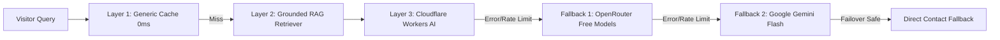

<div align="center">

  <h1>🌐 Monish D — AI-Native Portfolio 🤖✨</h1>
  <p><strong>Building that matters, rather doable.</strong></p>

  <p>
    <a href="https://monishd.vercel.app/">
      
    </a>
    &nbsp;
    <a href="https://github.com/Monish-D609/Portfolio">
      
    </a>
    &nbsp;
    <a href="https://www.linkedin.com/in/monish-d07/">
      
    </a>
  </p>

  <p>
    🔗 <strong>Live Deployment:</strong> <a href="https://monishd.vercel.app/"><strong>https://monishd.vercel.app/</strong></a>
  </p>

</div>

---

### **About The Project** 💡

This is an **AI-powered, interactive portfolio** that transforms the traditional static "About Me" resume into an intelligent, conversational experience. Instead of endlessly scrolling through text, visitors can interact with a responsive 3D avatar that answers questions about Monish's background, research, work experience, projects, and skills in real time.

Built with Next.js 16 (Turbopack), Tailwind CSS, Framer Motion, and a 3-tier resilient AI inference engine, this portfolio doesn't just show credentials—it communicates and adapts dynamically to recruiters, developers, and collaborators.

---

### **Key Highlights & Features** ✨

*   **🗣️ Interactive 3D AI Avatar:** Engage in real-time fluid conversation. Ask anything about technical architecture, internships, research, or personal interests and receive instant, grounded responses.
*   **💼 "Looking for a talent?" Open Invitation:** Direct top-left portal showcasing Monish's target roles, production Agentic AI credentials, Multimodal LLM research, and 1-click contact routing.
*   **⚡ Zero-Latency Generic Cache & RAG Engine:** Pre-cached deterministic routes guarantee 0ms instant responses for standard queries while maintaining 100% factual accuracy with zero LLM credit burn.
*   **🔬 Grounded Experience & Research Cards:**
    *   **Open to Work & Engineering Focus:** Core agentic loop architecture, system-prompt engineering, FastAPI/OpenAPI hardening, simulation test rigs, and Docker/Cloud Run deployments.
    *   **IIT Mandi VIML Lab:** Multimodal LLM-based Video Summarization grounding LLM reasoning in vision semantics (SumMe Kendall’s $\tau = 0.253$).
    *   **Beside's Coding (Nexie.ai & Runable AI):** Reddit growth engineering (1,000+ users in 30 days) and award-winning international affiliate marketing ($21M Series A).
*   **🎨 Premium Fluid Design System:** Custom typography (Bricolage Grotesque + Satoshi + JetBrains Mono), smooth dark/light mode toggle, fluid cursor animations, and glassmorphic micro-interactions.
*   **🎵 Live Spotify Telemetry:** Real-time widget syncing with Spotify API displaying current playback status.

---

### **Tech Stack** 🛠️

| **Category**           | **Technology**                                                                                                        |
| ---------------------- | --------------------------------------------------------------------------------------------------------------------- |
| **Framework & Core**   | [Next.js 16](https://nextjs.org/) (App Router, Turbopack), [React 19](https://react.dev/), [TypeScript](https://www.typescriptlang.org/) |
| **Styling & Motion**   | [Tailwind CSS v4](https://tailwindcss.com/), [Framer Motion](https://www.framer.com/motion/), [Radix UI](https://www.radix-ui.com/) |
| **AI Inference**       | [Cloudflare Workers AI](https://ai.cloudflare.com/) (Primary), [OpenRouter](https://openrouter.ai/) (Fallback 1), [Google Gemini](https://ai.google.dev/) (Fallback 2) |
| **SDK & Streaming**    | [Vercel AI SDK v4](https://sdk.vercel.ai/docs) (`streamText`, Data Stream Protocol)                                   |
| **External APIs**      | [Spotify Web API](https://developer.spotify.com/), [GitHub REST API](https://docs.github.com/en/rest)                  |
| **Deployment**         | [Vercel](https://vercel.com/) — Live at [monishd.vercel.app](https://monishd.vercel.app/)                             |
| **Package Manager**    | [pnpm](https://pnpm.io/)                                                                                              |

---

### **Architecture & AI Fallback Pipeline** 🧠

The chat backend employs a multi-tier defense architecture to guarantee 100% uptime:



1. **Layer 1 (Generic Cache):** Sub-10ms streamed responses for frequent questions (skills, resume, projects, contact, opportunities).
2. **Layer 2 (RAG Grounding):** Injects verified knowledge base facts to eliminate hallucinations.
3. **Layer 3 (Cloudflare Workers AI):** Primary serverless edge LLM execution (`llama-3.1-8b-instruct-fp8`).
4. **Fallback 1 (OpenRouter):** Zero-downtime free model routing.
5. **Fallback 2 (Google Gemini):** High-reliability cloud inference.

---

### **Getting Started** 🚀

#### **Prerequisites**
- Node.js (v18 or higher)
- pnpm package manager (`npm install -g pnpm`)

#### **Local Setup**

1. **Clone the repository:**
   ```sh
   git clone https://github.com/Monish-D609/Portfolio.git
   cd Portfolio
   ```

2. **Install dependencies:**
   ```sh
   pnpm install
   ```

3. **Configure Environment Variables:**
   Create a `.env.local` file in the root directory:
   ```env
   # Live Deployment Base URL
   NEXT_PUBLIC_APP_URL="https://monishd.vercel.app"

   # AI Providers
   CF_ACCOUNT_ID="your_cloudflare_account_id"
   CF_API_TOKEN="your_cloudflare_api_token"
   # CF_MODEL="@cf/meta/llama-3.1-8b-instruct-fp8"

   OPENROUTER_API_KEY="your_openrouter_api_key"
   # OPENROUTER_MODEL="openrouter/free"

   GOOGLE_GENERATIVE_AI_API_KEY="your_google_gemini_api_key"
   # GOOGLE_MODEL="gemini-2.0-flash"

   # GitHub & Spotify
   GITHUB_TOKEN="your_github_personal_access_token"
   SPOTIFY_CLIENT_ID="your_spotify_client_id"
   SPOTIFY_CLIENT_SECRET="your_spotify_client_secret"
   SPOTIFY_REFRESH_TOKEN="your_spotify_refresh_token"
   ```

4. **Run the development server:**
   ```sh
   pnpm dev
   ```

5. **Open local application:**
   Navigate to [http://localhost:3000](http://localhost:3000) in your browser.

---

### **Production Build & Deployment** 📦

To build for production:

```sh
pnpm build
pnpm start
```

This repository is continuously deployed to **Vercel** on every push to `main`:
👉 **[https://monishd.vercel.app/](https://monishd.vercel.app/)**

---

### **Contact & Connect** 📬

- **Portfolio:** [monishd.vercel.app](https://monishd.vercel.app/)
- **Email:** [monishpersonal609@gmail.com](mailto:monishpersonal609@gmail.com)
- **LinkedIn:** [linkedin.com/in/monish-d07](https://www.linkedin.com/in/monish-d07/)
- **GitHub:** [github.com/Monish-D609](https://github.com/Monish-D609)
- **Location:** Bangalore, India

---

### **License** 📄

Distributed under the **MIT License**. See [`LICENSE`](LICENSE) for details.
